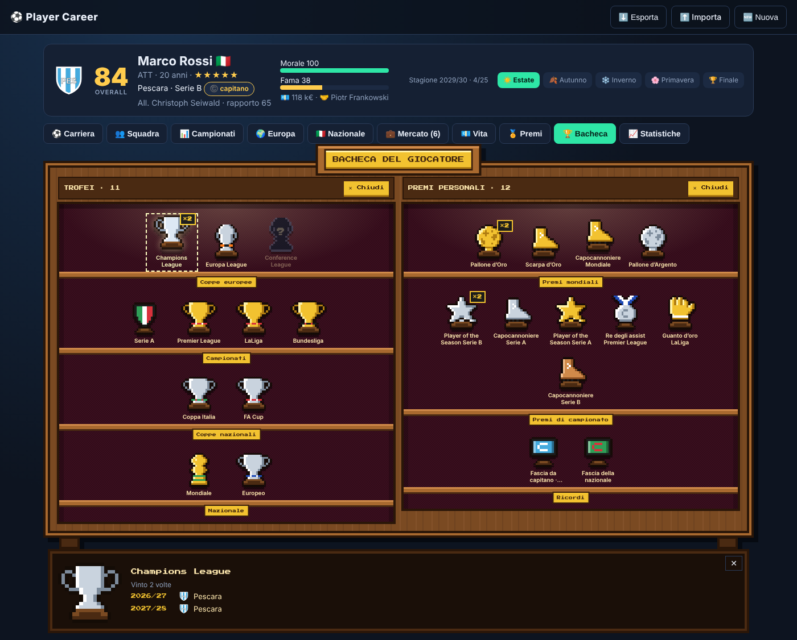
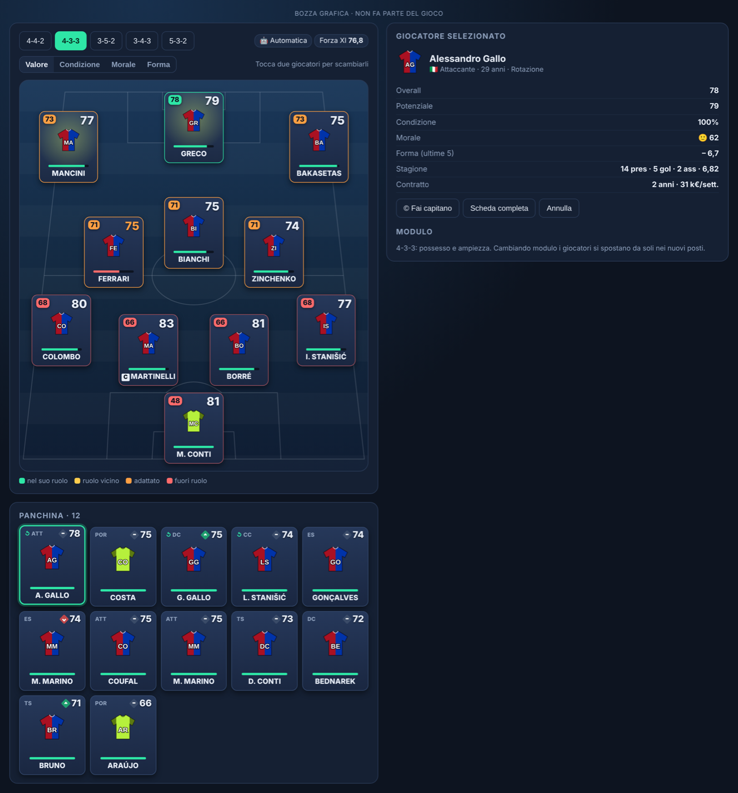
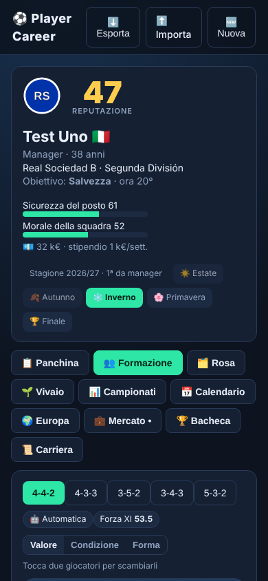

# ⚽ Football Career

A football career game that runs entirely in your browser. Create a player at 17, follow them for up to 25 seasons and chase goals, trophies and awards, or hang up the boots and take a bench as a manager.

The game is inspired by the Player Career of the 38-0-0 Dynasty Mode, with one goal: **more choices that matter, without slowing the pace down.** A season takes a minute or two and a handful of clicks.

**▶️ Play it in your browser: https://odex2.github.io/football-career/**

> The interface is currently in **Italian**.



## How to play

No install, no build, no server:

1. Download or clone this repository.
2. Double-click `index.html` (or open it in any modern browser).

You can also play it online, no download needed: https://odex2.github.io/football-career/ (hosted on GitHub Pages).

Your career is saved automatically in the browser (`localStorage`). Use **⬇️ Esporta** / **⬆️ Importa** to move a career to another browser or keep a backup as a JSON file.

The only external resource is the pixel font from Google Fonts; offline, the game falls back to a system font.

## Features

**Player career**
- Create a player: name, nationality, role, preferred foot and hidden traits (early bloomer, late developer, injury-prone...). Potential is only shown as a scouting star rating.
- Six attributes with their own age curves: pace and physique peak early, passing and positioning keep growing. Growth depends on talent, minutes, training focus, morale and injuries.
- Seasons split into five blocks (summer, autumn, winter, spring, finale), each with one quick choice and the occasional event card. "Next block" or "Simulate season" when you just want to see what happens.
- Playing time earned against your teammates, your relationship with the coach and your form.
- Transfer windows, loans, agents and contract talks (wage, length, promised role), renewals and transfer requests.
- Life off the pitch: morale, media reputation, press conferences, decisive match moments.
- Club legend: fan affection per club, "one-club man" status, rivalries, derbies and "traitor" moves to a rival.
- National team call-ups and international tournaments with groups and knockouts.
- Awards, a trophy cabinet, records, achievements, an animated end-of-career summary and a local Hall of Fame.

**Manager career**
- Start as a manager or move to the bench after retiring as a player.
- Formation and tactics editor, squad rotation, youth academy, the board and its expectations, the transfer market and the coaches' job carousel.
- Live matches with half-time decisions.

| Formation (desktop) | Manager (phone) |
|---|---|
|  |  |

## Project structure

Plain HTML, CSS and JavaScript. No framework, no npm, no bundler: classic `<script>` tags sharing one global namespace, `G`, so the game works straight from `file://`.

```
index.html          loads every stylesheet and script, in order
*.css               styles (no images: everything is CSS, emoji and inline SVG)
js/config.js        balance numbers for the player career (defines G)
js/config-mgr.js    balance numbers for the manager career
js/*.js             one responsibility per file, ~300 lines max
types/              TypeScript declarations used only for type checking
tests/              Node checks: data, types and fixed-seed careers
```

## Tests

Only [Node](https://nodejs.org) is needed. The type check also needs TypeScript **5.9** (`npm install -g typescript@5.9`); if it's missing, that step is skipped.

```bash
node tests/run.js           # everything: files, data, types, every test career (~2 min)
node tests/run.js --quick   # files, data and types only (seconds)
```

Each test career runs with a fixed seed and must match its fingerprint in `tests/golden.json`, so any change to the simulation is visible. See [CONTRIBUTING.md](CONTRIBUTING.md) for details, and [CHANGELOG.md](CHANGELOG.md) for the version history.

`G.debug.simCareers(n)` in the browser console simulates `n` careers without the UI and prints averages, useful for balancing.

## Disclaimer

This is a non-commercial fan project. It is not affiliated with, endorsed by or connected to any football club, league, federation or player. Any names are used for descriptive purposes only and all trademarks belong to their respective owners.

## License

[MIT](LICENSE)
